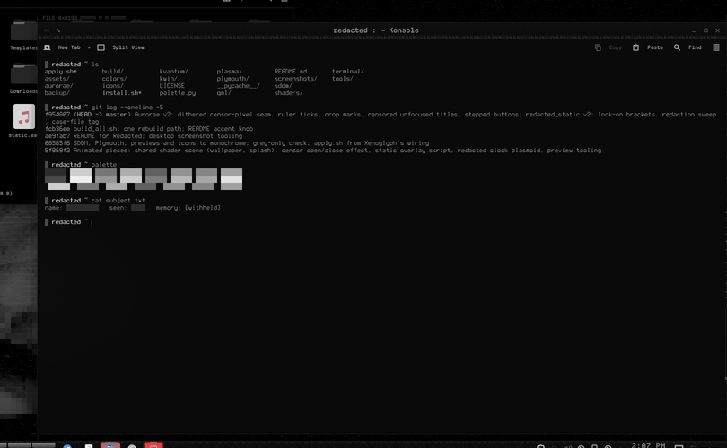
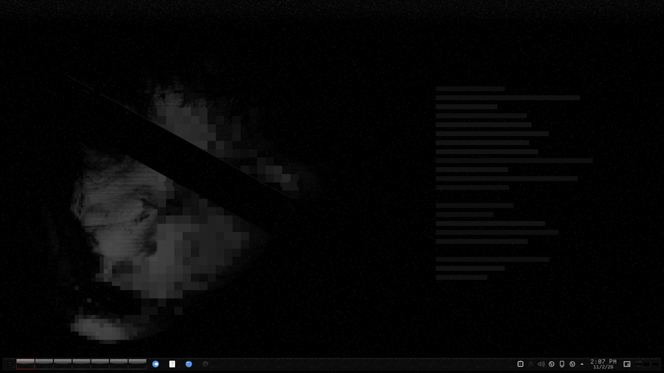
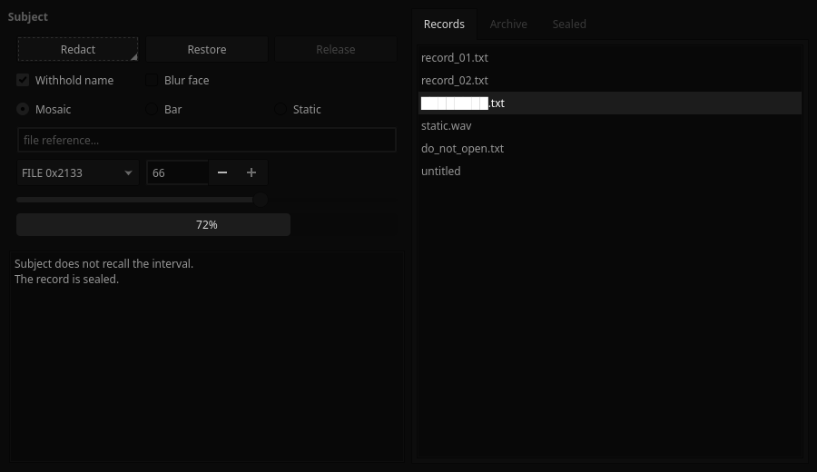
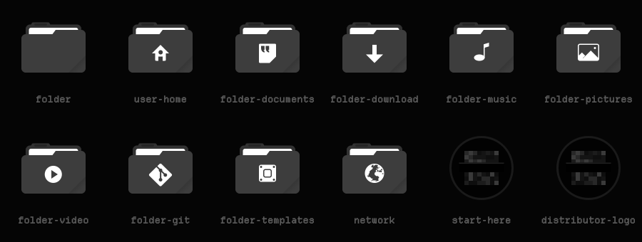
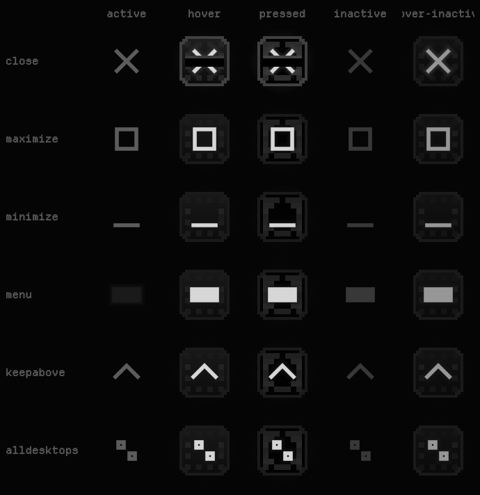

# Redacted

A monochrome-black KDE Plasma 6 suite about obfuscation and censorship. Every colour is a neutral grey, and the accents sit
only a few levels above black (`ACCENT_STEP` in `palette.py`): almost imperceptible, but just perceptible. The panel, frames,
splash, lock screen, login and boot splash carry the overtone: static, mosaic pixelation, censor bars and a dissociated double.

| | |
|---|---|
|  |  |
| Aurorae frame: dithered censor-pixel seam, ruler ticks, crop marks; unfocused windows are censored | KWin script: brackets lock on, a write head stamps censor bars round the edge, a case-file tag |
|  |  |
| KWin effect: windows open as mosaic and static under sliding censor bars | Splash: the mosaic resolves stage by stage |
|  |  |
| SDDM: the live scene behind a black panel | Plymouth: the censored face, censor-block progress |
|  |  |
| Kvantum widgets | Icons over Tela circle dark |

## Pieces

Each piece is also its own repo with an installer, screenshots and a KDE Store build.

| piece | repo | KDE Store category |
|---|---|---|
| Global theme + splash screen | [redacted-global](https://github.com/numbpill3d/redacted-global) | Global Themes (Plasma 6) |
| Plasma style (panel, popups) | [redacted-plasma](https://github.com/numbpill3d/redacted-plasma) | Plasma Themes |
| Aurorae window decoration | [redacted-aurorae](https://github.com/numbpill3d/redacted-aurorae) | Aurorae Themes |
| Colour scheme | [redacted-colors](https://github.com/numbpill3d/redacted-colors) | Plasma Color Schemes |
| Kvantum widget style | [redacted-kvantum](https://github.com/numbpill3d/redacted-kvantum) | Kvantum |
| Icon theme | [redacted-icons](https://github.com/numbpill3d/redacted-icons) | Full Icon Themes |
| Konsole + kitty colours | [redacted-konsole](https://github.com/numbpill3d/redacted-konsole) | Konsole color schemes |
| SDDM login | [redacted-sddm](https://github.com/numbpill3d/redacted-sddm) | SDDM Login Themes |
| Plymouth boot splash | [redacted-plymouth](https://github.com/numbpill3d/redacted-plymouth) | Plymouth Themes |
| Animated wallpaper (desktop + lock) | [redacted-wallpaper](https://github.com/numbpill3d/redacted-wallpaper) | Wallpaper Plugins |
| Still wallpaper (1080p–4K) | [redacted-image-wallpaper](https://github.com/numbpill3d/redacted-image-wallpaper) | Wallpapers KDE Plasma |
| KWin open/close effect | [redacted-censor](https://github.com/numbpill3d/redacted-censor) | KWin Effects |
| KWin script: active window under review | [redacted-static](https://github.com/numbpill3d/redacted-static) | KWin Scripts |
| Clock plasmoid | [redacted-clock](https://github.com/numbpill3d/redacted-clock) | Plasma 6 Applets |

## Use

    bash apply.sh            # install + switch (user level)
    bash apply.sh --revert   # back to the configs saved by the first apply
    sudo bash install.sh     # SDDM + Plymouth (dracut rebuild)

## Rebuild

    bash tools/build_all.sh && bash apply.sh    # every generator, scene staging, grey check

Accent strength is one knob, `ACCENT_STEP` in `palette.py` (levels above the surface):

    sed -i 's/^ACCENT_STEP = .*/ACCENT_STEP = 10/' palette.py && bash tools/build_all.sh && bash apply.sh

The SDDM and KSplash QML hard-code their greys, so the knob doesn't reach them.

Previews with real GPU shaders: `tools/nested-grab.sh` (headless nested KWin).
The KWin effect renders offline with `build/venv/bin/python tools/render-censor.py`.
Shader preamble from Burn-My-Windows (GPL-3.0-or-later). Wallpaper face: scorn's own.

Release: `bash tools/make-shots.sh && python3 tools/make-release.py` builds `repos/redacted-*` and the KDE Store kit in `~/Documents/Redacted Release`; `bash tools/publish-all.sh` pushes them.

## Tags

`redacted` `kde` `plasma6` `dark` `black` `monochrome` `grayscale` `minimal` `censored` `glitch` `static` `pixel` `kde-theme` `theme-suite` `sddm` `plymouth` `aurorae` `kvantum` `kwin-effect` `kwin-script`
